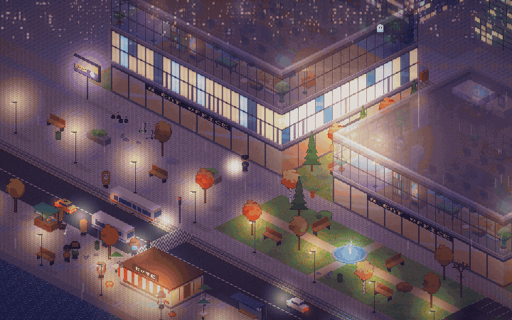
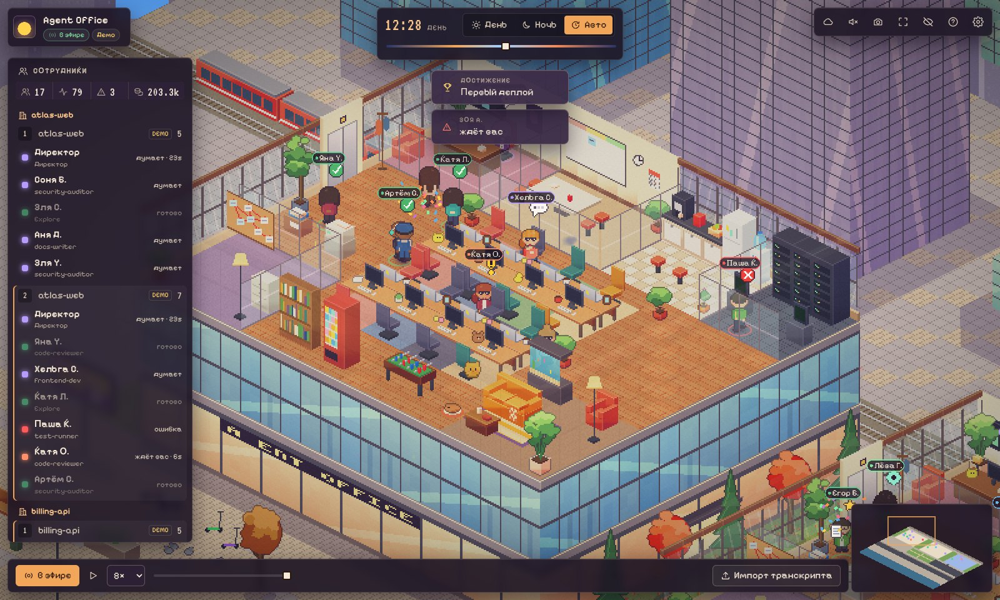
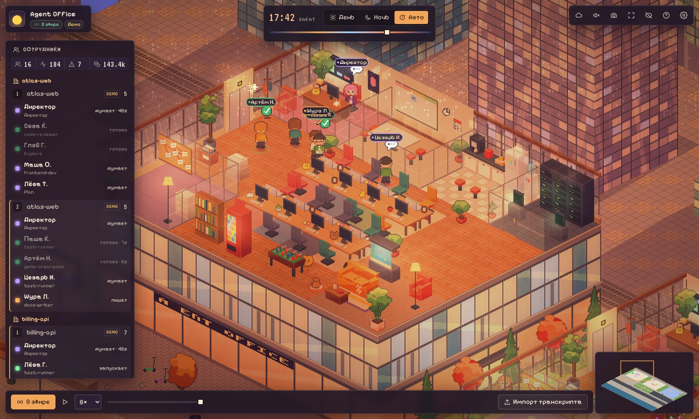
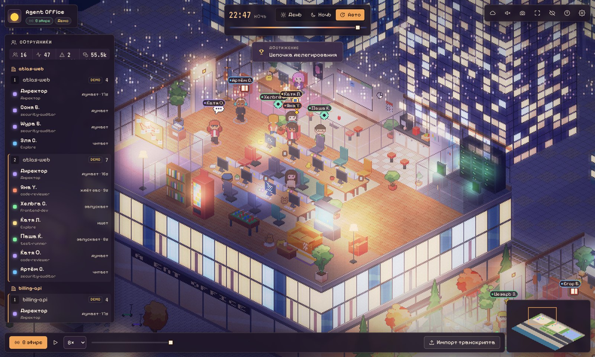
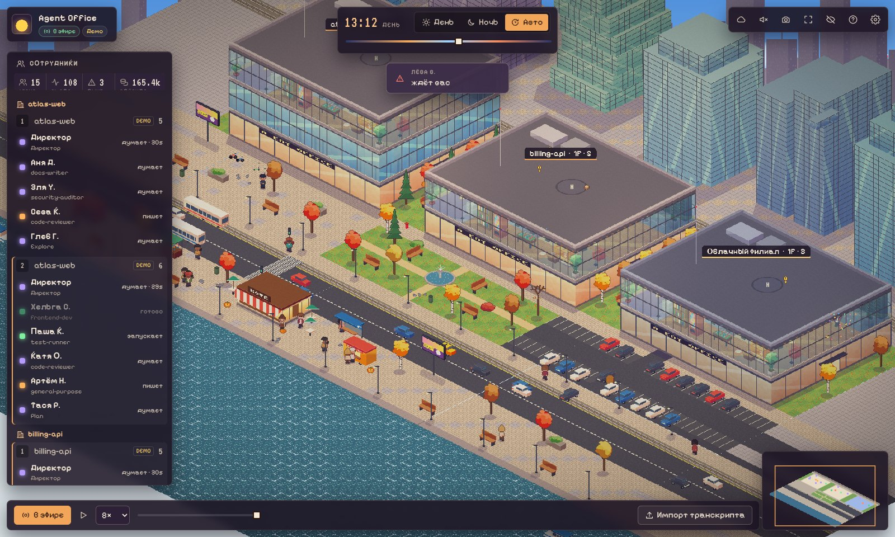
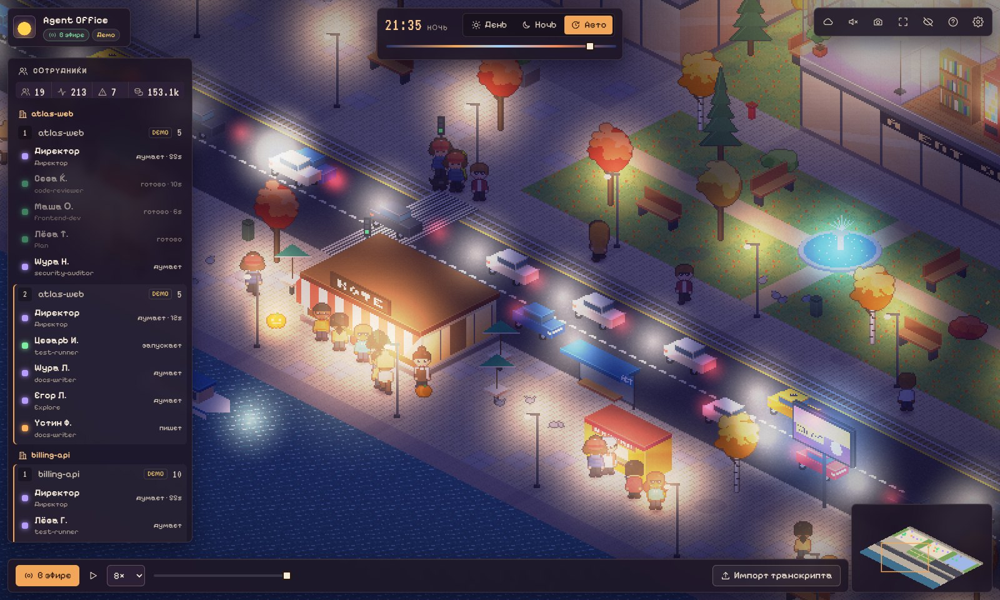
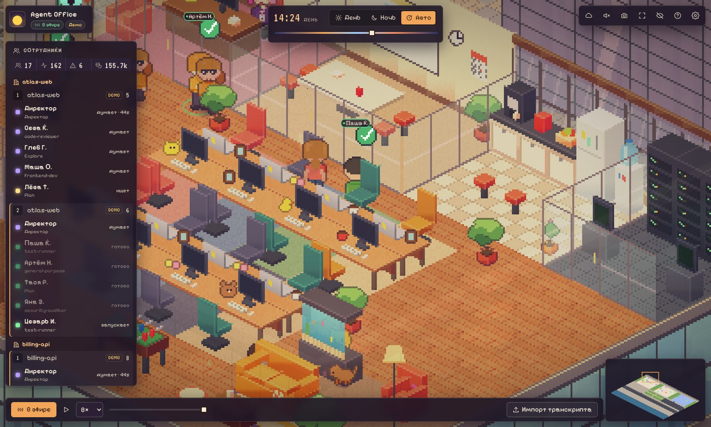

# Agent Office

**English** · [Русский](README.ru.md)

**An isometric pixel-art office for your Claude Code agents.** Every session is a storey in a glass tower in a Moscow City block, and every subagent is a worker: they walk from the elevator to a desk in their department, type, read, run tests in the server room and pin threads on the board in the analytics room. When they need you, they raise a hand. When they finish, they carry a document to the Outbox. Around the office there's a living city block with a 15-minute day/night cycle.



| Day | Sunset | Night |
|---|---|---|
|  |  |  |
| **The block** | **The street at night** | **Up close** |
|  |  |  |

More frames are in [`docs/screens/`](docs/screens): dawn. All phases of the day, plus rain, snow and fog: `npm run screenshots`.

## Install (2 minutes)

You need [Claude Code](https://code.claude.com) and [Node.js](https://nodejs.org) 20+. No cloning or `npm install`: everything is prebuilt.

```bash
claude plugin marketplace add whoamnesia/agent-office
claude plugin install agent-office@agent-office
```

Restart Claude Code, then type `/agent-office:office` in the chat and open the link it gives you. `/agent-office:office-demo` shows the office with demo agents.

Optional mini office in a panel beside the chat (early-access mod API), opened with `/office-panel`:

```bash
claude plugin install agent-office-panel@agent-office
```

Update: `claude plugin marketplace update agent-office && claude plugin update agent-office@agent-office`. Remove: `claude plugin uninstall agent-office@agent-office`.

### From source (development)

```bash
git clone https://github.com/whoamnesia/agent-office && cd agent-office
npm install
npm run demo                    # demo office in a couple of seconds, no Claude Code needed
claude --plugin-dir ./plugin    # a real session with the plugin from this checkout
```

## Commands

| What | Command |
|---|---|
| Open the office (starts the local daemon, prints the URL, tries to open the browser) | `/agent-office:office` |
| Open the demo | `/agent-office:office-demo` |
| Mini office in a panel beside the chat (mod, optional, see below) | `/office-panel` |
| CLI | `node plugin/bin/agent-office start [--demo] [--open] \| stop \| status \| url \| replay <file.jsonl> [--speed 20] \| init-cloud [--dir <repo>] \| relay` |

npm scripts: `npm run demo`, `npm run dev` (daemon + Vite with hot reload), `npm run build`, `npm test`, `npm run test:e2e`, `npm run screenshots` (every phase of the day into `docs/screens/`), `npm run assets`, `npm run validate`.

## What's on screen

- **Workers.** The director (the main agent of the session) works in the glass office. Subagents come out of the elevator, walk to a desk in their department and sit down. When they finish, they carry a document to the Outbox, celebrate and leave.
- **Statuses.** Each status is shown three ways at once: an animation, an icon above the head and the colour of the ring under the feet. The monitor on the desk also changes.

  | Status | What you see |
  |---|---|
  | `thinking` | a "…" cloud |
  | `reading` | reading a book |
  | `writing` | typing fast |
  | `running` | goes to the server room |
  | `searching` | goes to the analytics room with the red threads |
  | `waiting_user` | raises a hand, "!" icon, a bell |
  | `error` | red screen and smoke |
  | `done` | confetti |
- **Departments.** Frontend, Backend, QA, Security, Docs, General and DevOps (the terminals in the server room) are picked automatically from file paths and commands. Rules are configurable (`deptRules`).
- **Projects and sessions.** Each project is a tower, each session is a storey. The open storey is a dollhouse cut; when you zoom in, the near walls and the roof become translucent. Cloud sessions go into the separate *Cloud Branch* tower.
- **Walls.** The kanban board shows real `TaskCreated`/`TaskCompleted`. The wall dashboard shows active agents, tool calls and errors.
- **The block.**
  - The MCC train passes in the background.
  - The road has taxis, a tram, a bus at the stop, a traffic light and a crosswalk.
  - A parking lot fills up in the morning and empties in the evening.
  - On the embankment: a café with a queue, a shawarma truck, a flower stall, a street musician, benches, pigeons that fly up, dogs.
  - A square with a fountain, river trams on the river.
  - Glass towers in the background, a skyline with a TV tower, clouds, a plane. At night: stars, the moon, neon and lit windows.
- **Background NPCs** are utility AI with daily schedules and queues: coworkers, a cleaner and a guard with a flashlight at night, a courier, a barista, a chef, a cat, the mascot Bublik.
- **NPCs react to agents.** They bring coffee after an error, look over a shoulder during long thinking, stand nearby while a worker waits for you, deliver packages and applaud closed tasks.
- **Day and night.** A full cycle takes 15 minutes (`dayCycleMinutes`). Use the Day / Night / Auto buttons, the slider, or the `N` key. Lighting is a shader composite with tinted shadows, bloom and screen glow on faces; nothing is baked into the sprites.
- **Weather.** Clear, rain with splashes, snow or fog. In auto mode it follows project health: lots of errors bring rain, green tests bring a rainbow.
- **Seasons.** End of October means pumpkins. Friday evening means a disco ball. A wave of errors triggers the deadline banner.
- **Interface.**
  - Team list grouped by tower and storey, and an agent card with a pixel portrait, recent tool calls, files and tokens.
  - Event feed with replay, scrubbing and speed control, plus transcript import (drag & drop a `.jsonl`).
  - Minimap and achievements.
  - Photo mode (`P`) and screensaver mode (`H`).
  - Settings: language, quality, FPS cap, reduced motion, colour-blind palette, UI scale, worker appearance.
- **Easter eggs.** A UFO over the park, a cat on an idle keyboard, a ghost in the server room at night.

Keys: `N` day/night/auto · `F` whole block · arrows/WASD move the camera · `+`/`−` zoom · `L` team list · `Space` pause replay · `P` snapshot · `H` hide the interface · `Esc` clear selection or close a dialog.

## Configuration

`${CLAUDE_PLUGIN_DATA}/agent-office.config.json` (user level). A project can override privacy and department settings in `.claude/agent-office.config.json`.

```jsonc
{
  "autostart": true,            // start the daemon on SessionStart
  "port": 47821,                // falls back to a random port if busy
  "showContent": false,         // show command lines, search queries, agent tasks (masked)
  "hidePaths": false,           // show only file extensions
  "dayCycleMinutes": 15,
  "dayMode": "auto",            // auto | day | night | manual (+ timeOfDay 0..1)
  "weather": "auto",            // auto | clear | rain | snow | fog
  "weatherFollowsHealth": true,
  "quality": "auto", "fpsCap": 60, "reducedMotion": "auto", "colorblind": false, "uiScale": 1,
  "seasonal": true, "lang": "auto",
  "deptRules": null,            // [{ "dept": "frontend", "glob": "src/web/**" }, { "dept": "qa", "command": "\\bpytest\\b" }]
  "relayUrl": null, "relayToken": null   // subscribe to a cloud relay
}
```

UI choices (time of day, weather, quality and so on) are saved back to this file from the browser.

## Privacy and security

- **By default only metadata leaves a hook:** the tool name, the project-relative file path, the status and the department. Bash shows only the program name (`npm …`).
- Prompts, file contents, tool responses and agent answers are never read into events. Tests check this.
- `showContent` adds masked, truncated commands and queries; `hidePaths` hides paths.
- Secrets are masked everywhere: bearer tokens, `KEY=…`, `--token=…`, `ghp_…`, `sk-…`, long base64 strings, `user:pass@` in URLs.
- The daemon listens on **127.0.0.1 only** and checks the access token (in the URL from `/agent-office:office`, removed from the address bar once read), `Origin` and `Host` (DNS-rebinding protection). Request bodies are size-limited. The UI runs under a strict CSP without `eval`.
- Hooks never slow Claude Code down or break it: `ao-emit` always exits 0, prints nothing, gives the network 300 ms, then writes to a spool. Measured: 38 ms median for the whole hook process, 52 ms p95.

## Cloud sessions (Claude Code on the web)

There is **no public API for live events** from cloud sessions. Their hooks run **inside the cloud VM**, which can't see your `localhost`. There are three honest options.

### A. Relay (main option)

1. **Deploy the relay.**
   - Cloudflare: `cd packages/relay && npx wrangler@3 deploy && npx wrangler@3 secret put AO_RELAY_TOKEN`.
   - Your own server: `AO_RELAY_TOKEN=$(openssl rand -hex 24) node plugin/bin/agent-office relay --port 8787`, behind TLS or a tunnel (`cloudflared tunnel --url http://127.0.0.1:8787`).
2. **Prepare the repository.**
   ```bash
   node plugin/bin/agent-office init-cloud --dir <repo>
   ```
   This writes `.claude/agent-office/ao-emit.cjs` (no dependencies) and the hooks into `.claude/settings.json` (`--relay-only`). Commit them.
3. **Configure the cloud environment.** These are settings of the environment, not of the repository. In the session title, open the environment menu, then **Edit**:
   - **Environment variables / secrets:** `AO_RELAY_URL=https://…` and `AO_RELAY_TOKEN=…`. **Never commit the token.**
   - **Network access:** add the relay host to *Allowed domains*, keeping *Allow package managers* ticked.
   - Details: https://code.claude.com/docs/en/cloud-environments#network-access
4. **Subscribe the local office.** Put `relayUrl` and `relayToken` in your config, or set `AO_RELAY_URL`/`AO_RELAY_TOKEN` in the environment of the daemon. Cloud sessions appear in the **Cloud Branch** tower, with the link state on its label and in the top bar.

Without the variables the emitter does nothing (no network, no files), so the committed hooks don't bother anyone. On a machine that also has the plugin installed, `--relay-only` keeps local events from being reported twice.

**Limitations.**
- It hasn't been verified that outbound HTTPS from a cloud VM reaches your relay; it depends on your environment's network policy. See [VERIFIED.md](docs/VERIFIED.md).
- The Cloudflare variant is unit-tested against web APIs but hasn't been deployed.
- The relay keeps the last 2000 events in memory only.

### B. Teleport

`claude --teleport <session-id>` moves a cloud session into your local terminal. From then on the regular plugin hooks work as in a local session.

### C. Transcript replay

Drag a session `.jsonl` (`~/.claude/projects/<project>/<session>.jsonl`) into the browser window, or run:

```bash
node plugin/bin/agent-office replay <file.jsonl>
```

Subagent transcripts from `<session>/subagents/` are picked up automatically. The replay has pause, speed control and scrubbing. This is history, not a live view.

## Optional extras

- **Session cost** via the status line, which a plugin can't set up for you. In `~/.claude/settings.json`:
  ```json
  { "statusLine": { "type": "command", "command": "node <path>/plugin/bin/ao-statusline" } }
  ```
- **Mini office in a panel (mod)** in `mods/agent-office-panel/`:
  - an isometric SVG office beside the chat on desktop, a text list in the terminal;
  - installed with `claude plugin install agent-office-panel@agent-office` (or `claude --plugin-dir ./mods/agent-office-panel`) and opened with `/office-panel`;
  - is an *early access* API, and mods don't draw in the cloud.

## Development

```text
plugin/              what Claude Code installs: manifest, hooks, commands, bin/, dist/ (built)
packages/protocol    zod schemas, hook → event mapping, privacy, transcripts
packages/daemon      ao-emit, daemon, CLI, demo, relay client
packages/relay       relay: Node + Cloudflare Worker/Durable Object
packages/office-core world model, layouts, A*, NPC AI, traffic, day cycle
packages/office-web  Vite + PixiJS 8.22 (WebGL), renderer and HUD
packages/asset-gen   procedural atlases (npm run assets)
docs/                RESEARCH.md · VERIFIED.md · ARCHITECTURE.md · ASSETS.md · screens/
tests/               unit · integration · e2e (Playwright) · fixtures from real sessions
mods/                optional terminal panel
```

Tests (`npm test`) cover:
- unit and integration: the protocol on real captured hook payloads, privacy, the world model, path reachability, the day cycle, the pipeline from hook to SSE, security, the relay and `init-cloud`;
- e2e (`npm run test:e2e`): the office comes up in under 5 s, the controls work, there are no console errors.

More in [ARCHITECTURE.md](docs/ARCHITECTURE.md) and [ASSETS.md](docs/ASSETS.md). All graphics and sound are generated by the project's own code, with no third-party assets. Fonts are from @fontsource under the OFL.

## Known limitations

- **Frame rate wasn't measured on a real GPU.** It was developed in an environment without a GPU. Under software rendering (SwiftShader) the scene runs at 2–12 FPS, so the 60 FPS target with 20 agents and 60 NPCs is **unverified**. There is an automatic quality drop, a 30/15 FPS cap, and a simulation that stays correct at any frame rate.
- **The Notification hook (`permission_prompt`, `idle_prompt`) didn't fire in headless mode,** so the mapping is covered only by tests. `PermissionRequest` was confirmed on a live session.
- **Two independent parallel sessions weren't run as separate CLIs.** A nested `claude -p` inherits the parent's `session_id`. Multiple floors and towers are covered by the demo and by tests.
- **More than two local projects share the second tower,** storeyed by session.

Licence: MIT.
