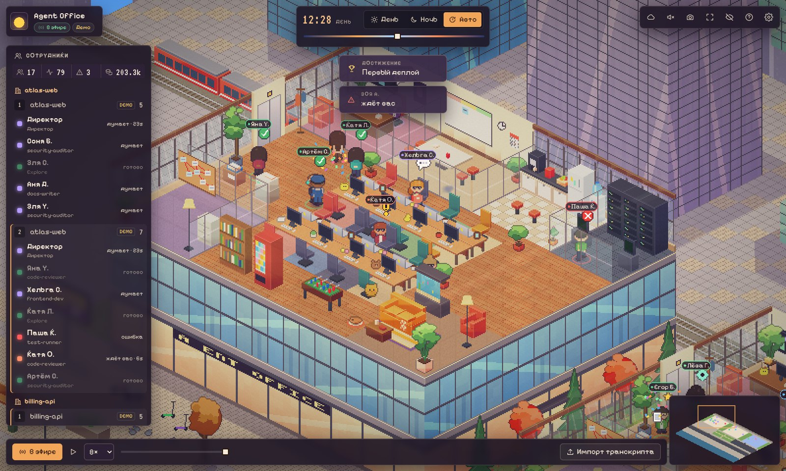
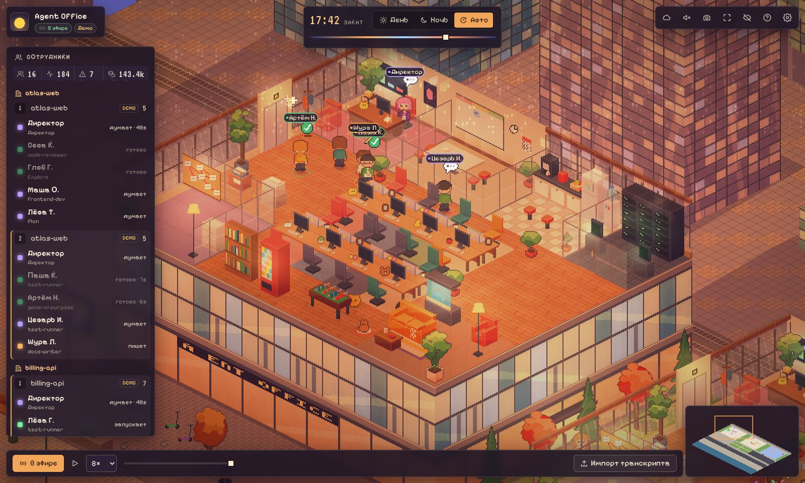
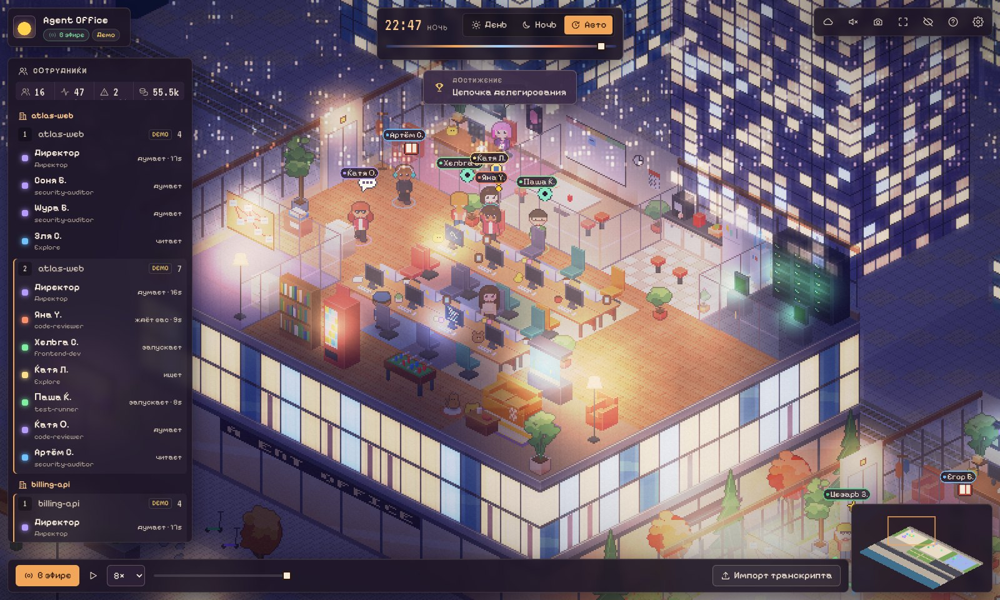

# Agent Office

[English](README.md) · **Русский**

**Изометрический пиксельный офис для агентов Claude Code.** Каждая сессия — этаж стеклянной башни в квартале Москва-Сити, каждый субагент — сотрудник. Он выходит из лифта, садится за стол в своём отделе, печатает, читает, гоняет тесты в серверной. Когда нужен вы — поднимает руку. Закончил — относит документ в «Исходящие». Вокруг живой квартал со сменой дня и ночи.


| День | Закат | Ночь |
|---|---|---|
|  |  |  |

## Установка за 2 минуты

**Что нужно заранее**

- [Claude Code](https://code.claude.com) — терминал или десктопное приложение.
- [Node.js](https://nodejs.org) версии 20 или новее. Проверить: `node -v` в терминале.

Клонировать репозиторий и запускать `npm install` **не нужно** — всё уже собрано.

### Шаг 1. Добавьте магазин плагинов

В обычном терминале (PowerShell, cmd, Terminal):

```bash
claude plugin marketplace add whoamnesia/agent-office
```

### Шаг 2. Установите офис

```bash
claude plugin install agent-office@agent-office
```

### Шаг 3. Перезапустите Claude Code

Закройте и откройте Claude Code (или новую сессию в приложении). Офис запустится сам, в фоне.

### Шаг 4. Откройте офис

Напишите в чате Claude Code:

```
/agent-office:office
```

Claude ответит ссылкой вида `http://127.0.0.1:47821/...` — откройте её в браузере. Готово: пока вы работаете, сотрудники в офисе делают то же самое.

> Хотите сначала посмотреть без настоящей работы? Команда `/agent-office:office-demo` откроет офис с демо-агентами.

<details>
<summary>Вместо терминала — команды внутри Claude Code</summary>

В интерактивном `claude` в терминале то же самое можно сделать слэш-командами:

```
/plugin marketplace add whoamnesia/agent-office
/plugin install agent-office@agent-office
/reload-plugins
```
</details>

## Мини-офис рядом с чатом (по желанию)

Маленькая версия офиса прямо в боковой панели Claude Code: директор за стеклом, субагенты за столами, анимации статусов и подсказки при наведении. В терминале панель показывает текстовый список.

```bash
claude plugin install agent-office-panel@agent-office
```

После перезапуска откройте её командой `/office-panel`.

Панель сделана на API модов, который пока в раннем доступе: может меняться между версиями Claude Code и не работает в облачных сессиях.

## Что вы увидите

| Статус агента | Как выглядит |
|---|---|
| думает | облачко «…» |
| читает | читает книгу |
| пишет | быстро печатает |
| запускает команды | идёт в серверную |
| ищет | идёт в аналитический отдел к доске с красными нитками |
| ждёт вас | поднимает руку, значок «!», колокольчик |
| ошибка | красный экран и дымок |
| готово | конфетти |

Цвет кольца под ногами и экран монитора тоже показывают статус.

**Управление:** `N` — день/ночь/авто · `F` — весь квартал · стрелки или WASD — камера · `+`/`−` — масштаб · `L` — список команды · `P` — снимок · `H` — скрыть интерфейс · `Esc` — закрыть.

## Обновление и удаление

Обновить до последней версии:

```bash
claude plugin marketplace update agent-office
claude plugin update agent-office@agent-office
```

Удалить:

```bash
claude plugin uninstall agent-office@agent-office
claude plugin marketplace remove agent-office
```

## Если что-то не работает

- **Команды `claude` нет в терминале.** Установите Claude Code по [инструкции](https://code.claude.com), затем откройте новое окно терминала.
- **`node` не найден или версия ниже 20.** Поставьте Node.js LTS с [nodejs.org](https://nodejs.org) и перезапустите Claude Code.
- **`/agent-office:office` не находится.** Плагин подхватывается только новой сессией — перезапустите Claude Code. Проверить, что он включён: `claude plugin list`.
- **Ссылка не открывается или офис пустой.** Ещё раз выполните `/agent-office:office` — команда сама поднимет офис, если он упал, и покажет путь к логу, если не получилось.
- **Порт 47821 занят.** Офис сам выберет свободный порт; актуальную ссылку всегда даёт `/agent-office:office`.

## Приватность

- Из хуков уходят только метаданные: имя инструмента, путь к файлу внутри проекта, статус и отдел. Ваши промпты, содержимое файлов и ответы агентов не читаются.
- Офис работает только на вашем компьютере (`127.0.0.1`) и защищён токеном в ссылке.
- Хуки никогда не тормозят и не ломают Claude Code: работают ~40 мс и всегда завершаются успешно.

## Дальше

Настройки (смена дня и ночи, погода, качество, правила отделов), облачные сессии, CLI и разработка описаны в английском [README](README.md#configuration). Для разработчиков: `git clone`, `npm install`, `npm run demo`.

Лицензия: MIT.
